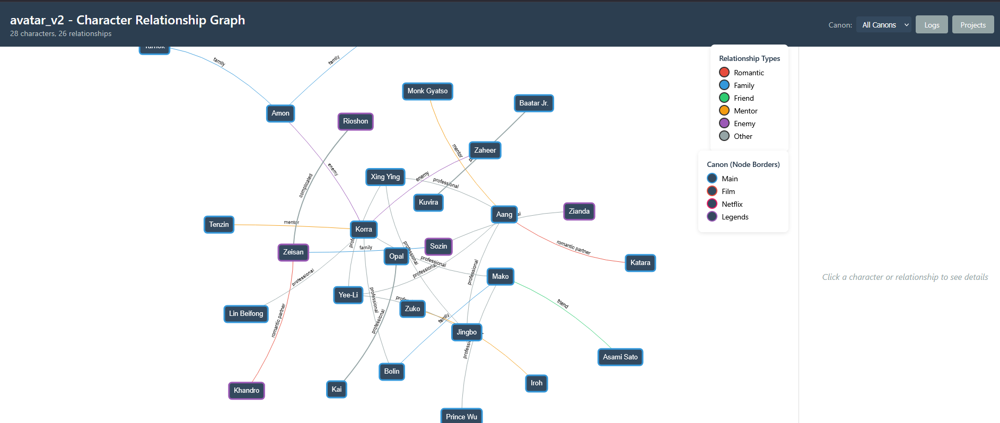
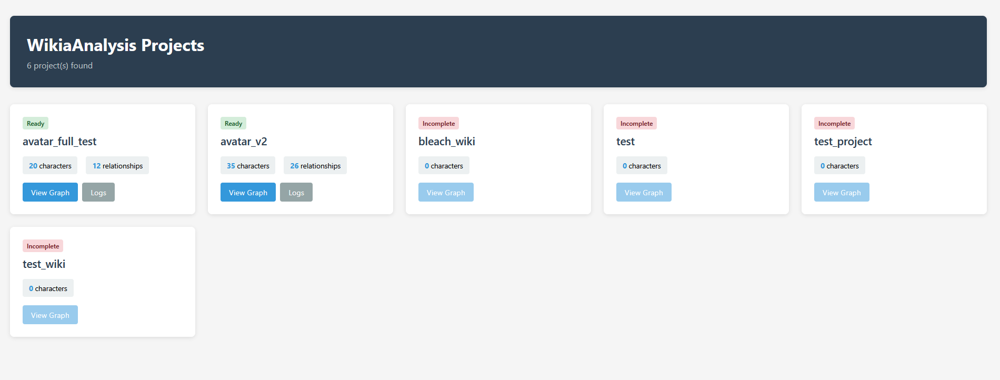
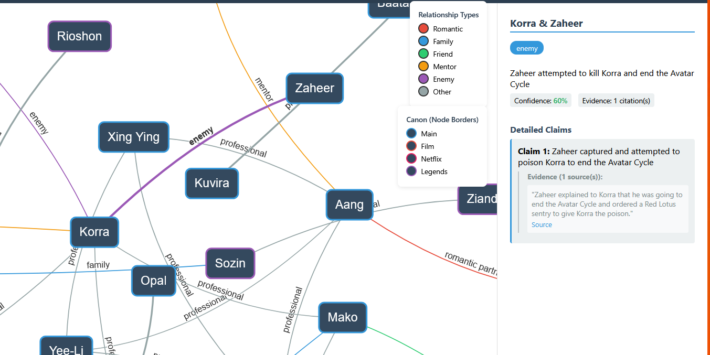

# Wikia Character Relationship Analyzer

Ingests a Fandom/Wikia wiki, uses Claude to extract characters and the relationships between them, and visualizes the result as an interactive graph. Every relationship is backed by an exact quote from the ingested pages, so the graph reflects what the wiki says - not what the model happens to remember.

## Screenshots

### Interactive Relationship Graph

*Force-directed graph of characters and their relationships*

### Project Dashboard

*Web dashboard for browsing analyzed wiki projects*

### Evidence Viewer

*Click any relationship to see its claims and the quotes that support them*

## Features

- **Reads whole pages** - long pages are processed in windows, so nothing past the first screenful is lost
- **Verified evidence** - every relationship carries at least one claim whose quote is checked, in code, to appear on the cited page
- **Respectful crawling** - rate limiting and robots.txt compliance; never circumvents bot protection
- **Interactive visualization** - zoomable graph, click a character or relationship to inspect it
- **Resumable, cost-capped runs** - discovery skips finished pages on restart; `--max-cost` stops a run at a budget
- **Multi-canon support** - keeps alternate continuities (e.g. film vs animated series) separate

## Status and known issues (October 2026)

- **Crawling Fandom is currently blocked.** Fandom serves a Cloudflare bot challenge to non-browser requests, so `crawl` saves 0 pages. Fetching via the wiki's official MediaWiki API (`api.php`) still works and is the planned fix. This project will not attempt to get around the challenge.
- **`validate` is out of date** - it looks for a `graph.json` file from an older architecture and reports nothing useful.
- **`status` misreports indexing** as "Not started" and shows an obsolete "Profiles" phase.

## Quick Start

```bash
# Install (or open the repo in the provided dev container, which does this for you)
python -m venv .venv && .venv/bin/pip install -e ".[dev,rag,viz]"

# API key: put it in .env (loaded automatically by main.py)
echo 'ANTHROPIC_API_KEY=sk-ant-...' > .env

# Steps (crawl is currently blocked - see above)
python main.py crawl my_project https://avatar.fandom.com/wiki/Aang --max-pages 100
python main.py index my_project                    # chunk + embed pages into ChromaDB (local, free)
python main.py discover my_project --max-cost 1.00 # build the knowledge base with Claude
python main.py visualize my_project                # graph at http://localhost:8000/
```

`python main.py pipeline my_project <url>` runs crawl, index, discover and validate in sequence (`--skip-crawl` to reuse existing pages). `python main.py list` and `python main.py view <project>` show projects and sample content.

## How It Works

1. **Crawl** - Fetches wiki pages (respecting rate limits and robots.txt) and extracts the title, main text, infobox fields and links.
2. **Index** - Splits pages into ~500-character chunks, embeds them with a local sentence-transformers model, and stores them in ChromaDB. Used by the `search_wiki` tool during discovery.
3. **Discover** - Claude (Haiku 5.5 by default) reads every page, one window of ~6000 characters at a time, and records characters and relationships through tools. Each relationship claim must quote the page exactly; quotes are verified before they are stored.
4. **Visualize** - A Flask server renders the knowledge base as an interactive vis-network graph.

See [Architecture](docs/ARCHITECTURE.md) for details.

## Cost

Discovery is the only step that calls a paid API. With Claude Haiku 5.5 and prompt caching, measured costs are about **$0.08 for a very long page** (the 102,000-character Aang page) and a few cents or less for typical pages. Most of the cost is output tokens. Use `--max-cost` to cap a run; it can be resumed later.

## Project Data

Each project lives in `data/projects/<name>/` (gitignored):

```
processed/            # Crawled pages (one JSON file per page)
chroma.sqlite3        # ChromaDB vector index (plus a UUID-named directory)
characters/           # One JSON file per character: <name>_<canon>.json
relationships/        # One JSON file per pair: <char_a>_<char_b>_<canon>.json
cache/                # Crawl state, robots.txt cache, discovery_state.json (resume)
logs/                 # Application and LLM logs
```

## Technology Stack

- **Python 3.10+** (developed on 3.12), async crawling with **aiohttp** + **BeautifulSoup4**
- **ChromaDB 1.x** + **sentence-transformers** (`all-MiniLM-L6-v2`) for vector search
- **Anthropic Claude** via the `anthropic` SDK 1.x (default model `claude-haiku-5-5`)
- **Flask** + **vis-network** for visualization
- **pytest**: 743 unit tests (all LLM calls mocked) plus integration tests

## Configuration

Configuration files in `config/`:
- `crawler_config.yaml` - crawling settings (user agent, delays, namespaces)
- `rate_limits.yaml` - per-domain rate limits
- `processor_config.yaml` - chunking, embeddings, model, effort, prompt caching, discovery window size and per-page cap
- `llm_tools/` - the system prompt and tool definitions sent to Claude during discovery

## Documentation

- [Architecture](docs/ARCHITECTURE.md) - how the pipeline works
- [Data Schemas](docs/DATA_SCHEMAS.md) - JSON file formats
- [Development Guide](docs/DEVELOPMENT.md) - setup, testing, code quality
- [Logging](docs/LOGGING_STRATEGY.md) - log files and LLM call tracking

## Contributing

```bash
python -m pytest -m unit       # fast unit tests
black src/ tests/ && isort src/ tests/
mypy src/
```

Development follows test-driven development; see [CLAUDE.md](CLAUDE.md) and the [Development Guide](docs/DEVELOPMENT.md).

## License

MIT License
